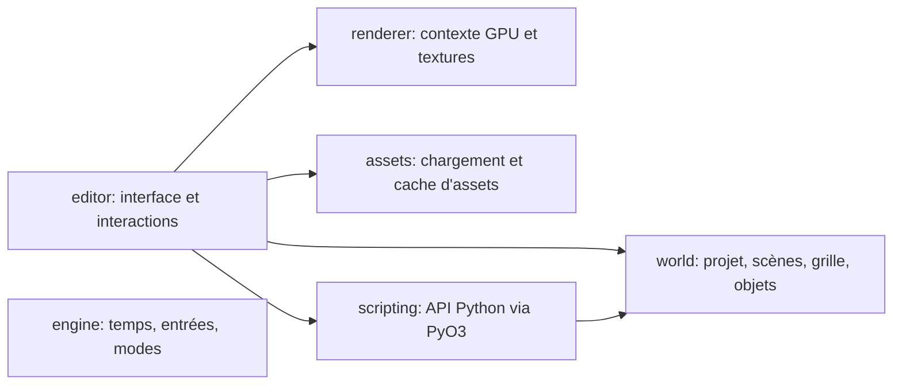

# Architecture du moteur de jeu isométrique

Ce document décrit l'architecture effectivement présente dans le dépôt. Les
objectifs qui ne sont pas encore implémentés sont suivis dans
[`PROGRESSION.md`](PROGRESSION.md) et [`TODO list.md`](../TODO%20list.md).
Le cahier des charges initial reste dans [`PROMPT BASE.md`](PROMPT%20BASE.md) ;
il décrit des besoins, pas nécessairement des fonctions déjà disponibles.

## Vue d'ensemble

Le workspace Rust est organisé en crates spécialisées. L'éditeur est le point
d'entrée utilisable aujourd'hui : il combine la scène isométrique, les outils
d'édition et l'inspecteur dans une interface `egui` rendue avec `wgpu`.



## Crates

| Crate | Responsabilité actuelle |
|---|---|
| `crates/world` | Modèles sérialisables du projet, du monde, des scènes, des tuiles et des objets ; coordonnées et projection isométriques. |
| `crates/editor` | Application `egui`/`winit`, caméra, outils de scène, inspecteur, panneaux, sauvegarde et chargement des projets. |
| `crates/renderer` | Initialisation `wgpu` et primitives de texture GPU. |
| `crates/assets` | Types de handles, registre/cache et chargement d'images PNG/JPEG. |
| `crates/engine` | Structures de temps, entrées et modes de fonctionnement du moteur. |
| `crates/scripting` | Runtime Python embarqué via PyO3, contexte accessible aux scripts et file de commandes. |

L'éditeur possède son propre affichage de la grille et des textures de scène ;
`renderer` fournit le contexte et les ressources GPU, mais ne constitue pas
encore un moteur de rendu de jeu complet.

Le dessin de la vue prépare un index des définitions de tuiles pour le frame,
afin de faire les recherches par identifiant en temps constant au lieu de
parcourir la palette pour chaque tuile visible. Les objets temporairement
déplacés sont également indexés par identifiant pendant le dessin. Les formes de
tuiles, contours, surbrillances et grille sont regroupées dans des meshes egui ;
les tuiles texturées sont regroupées par texture. Cela évite de créer et
tesseller une forme egui distincte pour chaque losange et chaque segment de
grille. Les hooks Python sont repérés au chargement : les callbacks absents sont
ignorés sans appel Python par frame. Les instantanés de scène ne sont copiés
qu'en présence de callbacks concernés et sont réutilisés entre les hooks si le
hook monde n'a pas émis de commande.

Pendant Lecture, le moteur ne construit pas d'instantané de la scène pour les
mises à jour monde/objet si aucun de ces hooks n'est chargé. La recherche des
chevauchements de zones et leurs instantanés sont également évités quand aucun
script ne déclare de callback de zone.

Les coûts qui restent à mesurer sur des projets représentatifs sont le tri de
tous les objets à chaque frame, les instantanés nécessaires aux scripts Python
et le calcul des événements de zones. La mise en cache persistante ou le
changement de modèle de rendu doit être guidé par ces mesures, car la scène
reste modifiable par les outils et callbacks.

## Modèle de projet et persistance

La hiérarchie persistante est :

```text
Project (un monde)
└── World (script Python, plusieurs scènes, scène active et scène principale)
    └── Scene (métadonnées, grille, objets)
```

Un projet porte une version de format. Chaque scène contient ses dimensions de
tuile, sa grille et ses objets. Le projet possède aussi sa palette de tuiles :
les six types historiques sont fournis par défaut et les définitions ajoutées
sont propres au projet. Elles sont sérialisées dans `.isomaker` et écrites dans
`<projet>/tiles/tile-<id>.json`. Une définition contient son identifiant, son
nom, sa couleur, une texture facultative (PNG, JPEG ou GIF animé), un indicateur
de collision, une option de rotation pseudo-aléatoire de la texture par case et
un indicateur `editor_only`. Ces tuiles restent visibles dans l'éditeur et sont
omises du rendu en Lecture, y compris à faible zoom. Les anciens projets
chargent ce champ à `false`. Les textures sont importées dans les assets du
projet. Une définition personnalisée peut être supprimée après confirmation ;
les cases qui la référencent sont effacées dans toutes les scènes et les fichiers
`tile-<id>.json` obsolètes sont retirés à l'enregistrement. La collision est une
métadonnée utilisée pendant les déplacements en Lecture.
Les types d'objets personnalisés sont aussi sérialisés dans `.isomaker`, avec un
UUID stable, un nom et un schéma de propriétés typées. Les valeurs par défaut génériques du type sont aussi sérialisées et copiées aux nouvelles instances. Les champs texte, entiers,
décimaux, booléens et scène ont une valeur initiale copiée à la création de
chaque instance ; les valeurs des instances sont indépendantes. Le champ scène
est choisi dans la liste des scènes existantes. Les modifications de schéma
synchronisent les instances, et renommer ou supprimer une scène actualise les
valeurs de scène qui la référencent.
La grille est clairsemée : seules les données
non vides sont réparties dans des chunks de 16 × 16 tuiles. Les objets ont un
identifiant stable, une position logique, une empreinte, une couche, des
propriétés et, éventuellement, un chemin de texture. Le script Python est
associé au monde.

Le fichier de projet est un JSON avec extension `.isomaker`. Enregistrer inclut
l'ensemble du projet (monde et scènes), pas uniquement la scène affichée.
L'ouverture et l'enregistrement utilisent les dialogues de fichiers Windows.
`Ctrl+S` enregistre le fichier courant ou ouvre « Enregistrer sous » lors du
premier enregistrement.
À la fermeture via la croix ou **Fichier → Quitter**, l'état sérialisé du projet
est comparé à son dernier enregistrement. Si des changements restent à sauver,
l'utilisateur peut sauvegarder et quitter, quitter sans sauvegarder ou annuler.
Cette confirmation est activée par défaut et peut être désactivée dans les
paramètres de l'éditeur.

Les textures sont copiées dans un dossier propre au projet, voisin du fichier :

```text
mon_projet.isomaker
mon_projet/
├── assets/
│   └── textures choisies par l'utilisateur
└── tiles/
    └── tile-00007.json
```

Les objets et les tuiles enregistrent un chemin relatif de la forme
`mon_projet/assets/nom.ext`, résolu depuis le dossier contenant le fichier
`.isomaker`. Au premier enregistrement, les textures référencées sont copiées
dans ce dossier et les chemins du projet sont actualisés. Une texture choisie
après l'enregistrement est copiée directement dans le même dossier. Les
collisions de noms de fichiers reçoivent un suffixe. Les textures intégrées au
dépôt sous `assets/` ne sont pas automatiquement liées aux objets. Le panneau
Assets est un gestionnaire de fichiers enraciné dans le dossier `<nom_du_projet>/`
à côté du fichier `.isomaker`; il permet de naviguer dans `assets/`, `scripts/`
et les autres fichiers du projet. Un double-clic ouvre un fichier avec son application
Windows par défaut. Les menus contextuels permettent de créer des fichiers et
dossiers ainsi que de renommer les éléments. Un renommage met à jour les
chemins de texture des objets et des tuiles, la propriété `texture` des objets,
les scripts d'objets et le script du monde, puis sauvegarde le projet.

Dans l'inspecteur, les champs texture et script proposent séparément jusqu'à
douze derniers fichiers utilisés. Les textures sont filtrées aux formats PNG,
JPEG et GIF ; les scripts aux fichiers `.py`. Les chemins récents sont
sauvegardés dans les préférences de l'éditeur et seules les références existantes
sont affichées. Le bouton adjacent conserve le sélecteur de fichiers Windows.

Le script Python du monde suit le même principe de portabilité : la fenêtre
**Monde → Script du monde** copie le fichier choisi dans le dossier
`<nom_du_projet>/scripts/`. Le champ `script` du monde contient un chemin
relatif depuis le dossier du fichier `.isomaker`. Lors du premier
enregistrement ou d'un « Enregistrer sous », le script est copié vers le
dossier du nouveau projet.

## Coordonnées, grille et caméra

La grille utilise des coordonnées logiques entières `(x, y, z)`. La projection
dimétrique par défaut est de **64 × 32 pixels par tuile** (largeur × hauteur,
avant zoom), définie dans les métadonnées de scène. Pour une tuile `(x, y, z)`,
la projection relative à l'origine est :

```text
screen_x = (x - y) × tile_width / 2
screen_y = (x + y) × tile_height / 2 - z × tile_height
```

Le zoom et le déplacement sont portés par la caméra de l'éditeur. Le zoom est
centré sur le pointeur : le point logique sous la souris reste fixe pendant le
changement d'échelle. Les coordonnées de la souris sont reconverties dans le
repère de la scène avant le test d'appartenance au losange, pour que la tuile
survolée corresponde à sa surface affichée.

À faible zoom, la vue regroupe l'affichage des tuiles peintes par chunks et
réduit la densité de la grille. Les lignes restent ancrées aux coordonnées du
monde afin d'éviter qu'elles glissent par rapport aux tuiles pendant le zoom.
L'affichage de la grille et ses couleurs sont des options de vue de l'éditeur ;
elles ne sont pas enregistrées dans le projet. La couleur est sauvegardée dans
les préférences globales de l'éditeur (`%APPDATA%/MoteurDeJeu/editor_settings.json`).
L'option qui masque la grille ne s'applique qu'en Lecture et en Pause. Les
dimensions de tuile sont stockées par scène, mais ne disposent pas encore d'un
contrôle dédié dans l'UI.

## Interactions de l'éditeur

- **Peindre / Gomme** : applique ou efface des tuiles sous le pointeur, y
  compris pendant un glisser. Les raccourcis `F` et `G` activent respectivement
  Peindre et Gomme quand l'éditeur est actif et qu'aucun champ texte n'a le focus.
- **Sélection** : sélectionne une tuile ou une zone logique. `Shift` sélectionne
  les objets compris dans le rectangle sans sélectionner ni teinter les tuiles.
  Les objets sélectionnés peuvent être copiés avec `Ctrl+C` et collés sous le
  pointeur avec `Ctrl+V` ; leurs propriétés et écarts relatifs sont conservés,
  mais chaque copie reçoit un nouvel identifiant. Le presse-papiers de l'éditeur
  persiste lors des changements de scène, ce qui permet le collage entre scènes
  du même projet. Si aucun objet n'est sélectionné, le raccourci conserve le
  copier/coller d'une tuile seule.
- **Déplacer** : déplace la zone sélectionnée avec un aperçu temporaire. Sans
  sélection, déplace l'objet touché, ou la tuile sous le pointeur. Les objets
  déplacés sont identifiés par leur empreinte visuelle.
- **Rotation** : fait tourner la sélection par quarts de tour successifs dans
  les deux sens, avec un aperçu pendant le glisser.
- **Remplir** : remplit les tuiles de la sélection ; sans sélection, remplace
  le composant contigu de tuiles identiques à celle sous le pointeur. Les tuiles
  vides ne remplissent que la tuile cliquée.
- **Suppression** : la suppression d'objets avec `Delete` ou le bouton de la
  liste de scène demande confirmation. Supprimer une zone contenant des objets
  demande confirmation avant de supprimer aussi ses tuiles. `Entrée` confirme et
  `Échap` annule. `Ctrl+D` désélectionne. `S`, `D`, `R`, `F` et `G` activent
  Sélection, Déplacer, Rotation, Peindre et Gomme.
- **Annuler / Rétablir** : s'appuie sur des instantanés de scène en mémoire.
  `Ctrl+Z` annule et `Ctrl+Y` rétablit la dernière modification.
- **Simulation** : `F9` lance ou reprend Lecture, `F10` arrête, `F11` met en
  pause.
- **Gestion des scènes en Lecture** : `game.load_scene(nom)` dans un script
  Python active une scène du monde et empile la scène quittée. `game.unload_scene()`
  revient à la scène précédente. Toutes les scènes restent sauvegardées dans le
  projet ; `game.transfer_object(id, nom, x, y)` déplace un objet existant vers
  une autre scène sans l'activer, en conservant son UUID, son script, ses propriétés
  et son étage. Le script choisit séparément d'appeler `game.load_scene(nom)`.
  Un transfert refusé par les collisions ne retire pas l'objet de sa scène d'origine.
  Les scripts de toutes les scènes sont chargés au lancement, mais seuls
  les scripts de la scène active sont mis à jour. Les modules Python gardent
  leur état lorsqu'une scène est quittée puis rechargée. Arrêter la Lecture
  restaure le projet complet et la scène active de départ.
- La propriété `World.main_scene_index` sélectionne la scène de démarrage.
  Elle se règle dans **Monde → Scène principale (Main)** et retombe sur
  l'index `0` dans les anciens projets.
- **Gestion des scènes dans l'éditeur** : le menu **Scènes** permet de changer
  de scène ; clic droit sur une entrée permet de la renommer ou de la supprimer.
  La dernière scène ne peut pas être supprimée.
- **Paramètres éditeur** : **Fichier → Paramètres de l'éditeur** ouvre les
  préférences propres à l'application. Elles sont enregistrées séparément du
  projet dans `%APPDATA%/MoteurDeJeu/editor_settings.json`. L'option de masquage
  de la grille n'agit qu'en Lecture et en Pause ; la couleur de la grille y est
  aussi réglable et sauvegardée.
- **Inspecteur** : sa largeur minimale est réduite ; les libellés restent sur
  une ligne et sont coupés au bord du panneau s'il devient trop étroit, sans
  ellipse ajoutée.
- **Projets récents** : le sous-menu **Fichier → Projets récents** garde les dix
  derniers projets ouverts ou enregistrés dans les paramètres globaux de l'éditeur.
- **Création de types d'objets** : l'onglet **Types** permet de créer et sélectionner des types ; leur définition
  (nom, valeurs initiales, propriétés génériques et typées) s'édite dans
  l'inspecteur. Chaque type définit aussi les valeurs initiales génériques
  (collisions, visibilité, ajustement et texture, empreinte, rotation, couche et
  script). La texture et le script peuvent être choisis avec les dialogues de fichiers Windows et sont importés dans le projet. Ces
  valeurs sont copiées à la création ; chaque instance conserve ensuite ses
  modifications. Les instances s'ajoutent depuis l'onglet **Scène**. Les
  propriétés de type **Scène** utilisent une liste des scènes existantes. Types
  et instances sont enregistrés dans le projet. Le panneau Bâtiments, les modules
  et prefabs ont été retirés de l'interface. `prefab_id` et `Building` restent
  uniquement pour lire les anciens projets.
- En mode Lecture, un indicateur FPS lissé apparaît dans le coin supérieur droit
  du viewport.
- **Caméras de scène** : une caméra est un objet déplaçable avec une position
  isométrique, un zoom réglable (0,1 à 10) et des contrôles pour activer le
  lissage du suivi et en régler la vitesse. Les caméras ne proposent pas les
  propriétés de rendu ou collisions qui ne s'appliquent pas à leur icône. La scène mémorise sa caméra
  principale. En Lecture ou Pause, le sélecteur du viewport permet d'utiliser
  l'une des caméras ou de revenir à la vue libre de l'éditeur. Le suivi de caméra
  interpole position et zoom pour éviter les sauts lors des déplacements. Les caméras sont
  représentées par une icône dans l'éditeur et ne sont pas dessinées comme des
  objets du jeu. Les anciennes scènes sans caméra restent compatibles.

Les opérations de glisser affichent leur aperçu avant de valider les données au
relâchement de la souris.

En modes Lecture et Pause, l'éditeur est en lecture seule : les outils, les
panneaux de modification, l'annulation/rétablissement et les raccourcis d'édition
sont désactivés. Les événements clavier ne déclenchent plus les raccourcis
Sélection/Déplacer/Rotation, `Ctrl+D` ou `Delete`. La vue de scène reste visible
et la molette est désactivée dans le viewport.

## Objets et textures

Tous les objets peuvent activer ou désactiver les collisions ; par défaut,
celles-ci sont désactivées. La propriété **Masqué** est désactivée par défaut ;
quand elle est activée, l'objet n'est ni dessiné ni ciblé par un clic dans la
vue, mais reste accessible dans la hiérarchie. Le chemin de texture est vide
par défaut et se modifie depuis l'inspecteur avec le sélecteur de fichiers
Windows. La case
**Ajuster** est activée par défaut : l'image est mappée dans le losange de la
tuile. Si elle est désactivée, l'image conserve son ratio et est contenue dans
le rectangle de la tuile. Les objets sans texture valide utilisent un rendu de
substitution et les textures chargées sont gardées en cache par la vue.

Pendant Lecture, un déplacement demandé par un script vérifie les collisions
si l'objet déplacé est solide. Il ne peut pas entrer dans une tuile dont le type
est solide, ni recouvrir un autre objet solide à la même élévation ; les deux
objets doivent avoir les collisions activées. Les empreintes rectangulaires sont
prises en compte. Un déplacement bloqué est ignoré silencieusement. Cette
première version ne calcule pas de poussée.

Les scripts d'objet peuvent aussi recevoir des événements de zone sans activer
les collisions physiques. Un script qui définit `_on_area_entered(game, other)`,
`_on_area_stayed(game, other)` ou `_on_area_exited(game, other)` fait de son
objet une zone rectangulaire. Le moteur compare les empreintes des objets au
même étage après les mises à jour Python de la frame. `other` est un instantané
en lecture seule (`GameObject`). L'empreinte se règle dans l'inspecteur. Les
formes libres, le filtrage par type/couche et les événements de collision
physique restent à développer.

Le contenu de la case « Ajuster » est sérialisé sur l'objet. Les anciens objets
qui n'ont pas ce champ sont chargés avec la valeur par défaut `true`.

## Python et runtime

`scripting` embarque Python via PyO3. Le monde possède un script Python unique,
configuré depuis son menu **Monde**. À Lecture, le runtime appelle
`_on_game_launch(game)` une fois, puis `_on_update(game, delta_time)` à chaque
mise à jour. Si le script choisi est vide, l'éditeur y écrit ces deux fonctions
avec un corps `pass`. Le runtime conserve aussi la compatibilité avec les hooks
globaux historiques `on_start(game)`, `on_update(game, delta_time)` et
`on_stop(game)`.

Lecture est refusée si aucun chemin de script du monde n'est défini ou si le
fichier ne peut pas être chargé ; dans ce cas la fenêtre Monde s'ouvre pour
permettre de choisir ou créer le script.

`game` expose des méthodes qui ajoutent des commandes à une file ; Rust applique
les commandes après le retour Python. Les exceptions sont collectées par hook
et remontées à l'éditeur avec le chemin du script concerné.
Chaque callback reçoit aussi un instantané en lecture seule des objets de la
scène. `game.get_object(uuid)` consulte un objet par ID et
`game.find_object(name)` le cherche par nom exact ; les champs de cet instantané
incluent sa position. Le monde et les scripts d'objet disposent de ces méthodes.

Les signatures, méthodes disponibles, types de valeurs et exemples sont
détaillés dans [`PYTHON_API.md`](PYTHON_API.md).
Les annotations des scripts et le stub `python/engine_api/__init__.pyi` donnent
à Pylance les types nécessaires à l'autocomplétion. `.vscode/settings.json`
ajoute ce stub aux chemins d'analyse du dépôt ; les imports de `GameContext`
dans les scripts générés sont protégés par `TYPE_CHECKING` et ne s'exécutent
pas dans le runtime Python embarqué.
Un objet peut aussi avoir son propre fichier Python sélectionné ou créé depuis
l'inspecteur. Ses hooks `_on_game_launch(game)` et `_on_update(game, delta_time)`
sont exécutés pour cet objet, avec `game.object_id` et les méthodes `*_self`.
La position courante en coordonnées de tuile est exposée en lecture seule par
`game.x`, `game.y` et `game.z` dans ces callbacks.
Les autres champs de l'inspecteur sont consultables par getters et
`get_self_property` ; `set_self_property` met à jour les champs éditables ou
les propriétés personnalisées.
Chaque objet conserve une instance distincte du module ; ses callbacks cessent
d'être appelés lorsque l'objet est supprimé. Les détails figurent dans la
référence de l'API Python.
Les hooks `_on_update` reçoivent aussi un instantané clavier du frame avec
`game.key_pressed`, `game.key_just_pressed` et `game.key_just_released`. Le
clavier est capturé par la boucle winit et les états edge restent valables sur
tous les scripts du même frame. Les scripts choisissent les touches avec des
constantes typées (`game.keys.Z`, `game.keys.SHIFT`) ; les lettres suivent le
caractère logique pour fonctionner sur différentes dispositions de clavier.
Chaque log Python affiche le nom de son fichier script et, pour un script
d'objet, le nom de l'objet auquel il est attaché. Les logs d'information restent
dans le panneau de l'éditeur, où les doublons consécutifs sont regroupés, pour
éviter les écritures console synchrones par frame ; les avertissements et
erreurs sont aussi transmis au logger natif avec cette origine. Les lignes du
panneau peuvent être sélectionnées : `Shift` étend la sélection, `Ctrl` bascule
une ligne et `Ctrl+C` ou le bouton de copie place les logs sélectionnés dans le
presse-papiers. Le raccourci est associé au panneau Log ; ailleurs, `Ctrl+C`
conserve son comportement habituel.

L'API permet entre autres de créer, déplacer ou supprimer des objets, de changer
des propriétés, de lire l'état clavier et d'écrire dans les logs. Les scripts
restent du code de confiance : PyO3 ne constitue pas une sandbox. La lecture
d'état global, les entrées souris, les autres événements de jeu, le débogage
interactif et le pipeline de déploiement restent à développer.

Le binaire `player` partage la boucle graphique et les systèmes de scène avec
l'éditeur, mais charge directement un projet en Lecture et n'affiche pas les
panneaux d'édition. Il se lance avec le chemin d'un projet :

```powershell
cargo run -p editor --bin player -- chemin/vers/jeu.isomaker
```

Échap ferme le lecteur. Dans l'éditeur, **Fichier → Exporter le jeu** demande
un chemin de sortie Windows, sauvegarde le projet et lance l'export en arrière-
plan. Le résultat et les diagnostics sont transmis au panneau Log. Le script
`scripts/export_game.py` produit un ZIP portable contenant le binaire Release,
le projet et son dossier associé ainsi que la bibliothèque standard Python
correspondant à l'interpréteur configuré pour PyO3. Il vérifie le contenu et
l'intégrité de l'archive avant de signaler un succès. Les modules Python tiers
ne sont pas collectés automatiquement ; le ZIP doit être essayé sur une
installation Windows propre avant distribution.

## Démarrage

```powershell
cargo run -p editor
```

Le format `.isomaker` a actuellement `format_version = 1`. Toute évolution
incompatible de la structure persistée devra faire évoluer cette version et
prévoir la stratégie de migration ou de rejet des anciens fichiers.
